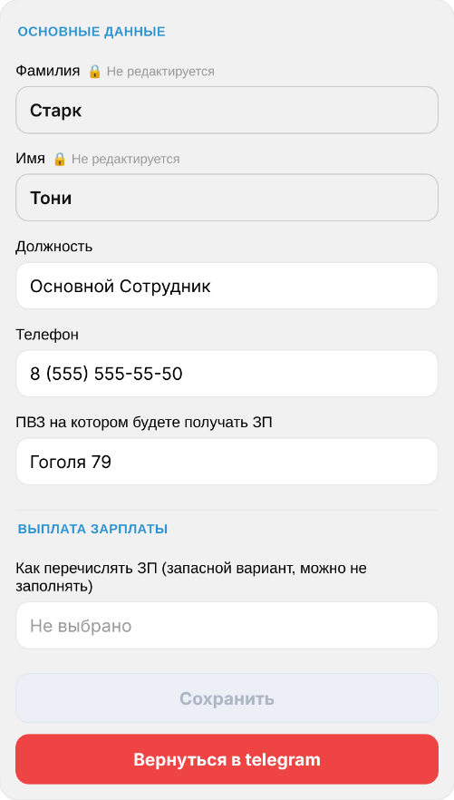

### Управление ПВЗ

Telegram-бот и веб-приложение для автоматизации работы сотрудников ПВЗ. Проект объединяет взаимодействие с Telegram, управление профилями сотрудников, работу с Google Sheets, хранение данных в PostgreSQL и Redis, а также выполнение фоновых задач.

  

#### Возможности

- **Telegram-бот** — обработка команд, сообщений, callback-запросов и пользовательских состояний.
- **Mini App** — веб-интерфейс для редактирования профиля и просмотра рейтинга сотрудников.
- **Управление профилями** — создание, редактирование и валидация данных сотрудников.
- **Рейтинг сотрудников** — получение статистики с использованием Redis.
- **Google Sheets** — работа с данными о выплатах, штрафах, опозданиях и уведомлениях.
- **Фоновые задачи** — обновление кэша таблиц, мониторинг уведомлений и синхронизация данных.
- **База данных** — хранение данных с использованием моделей и слоя доступа к данным.
- **Миграции** — управление изменениями структуры базы данных с помощью Alembic.
- **Минификация ресурсов** — уменьшение размера CSS- и JavaScript-файлов веб-приложения.

#### Технологии

- Python 3.13
- Aiogram
- FastAPI
- PostgreSQL
- SQLAlchemy
- Alembic
- Redis
- Google Sheets API
- Docker и Docker Compose

#### Требования
- Docker Compose.
- Токен Telegram.
- Доступ к Google Sheets API и JSON-файл с учётными данными сервисного аккаунта.
- Заполненный файл `.env` с переменными окружения.
